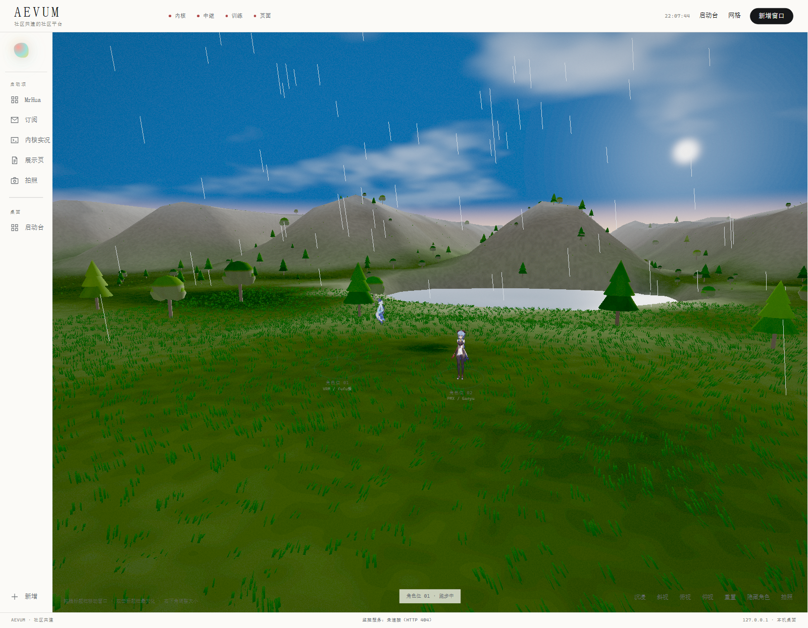

# Aevum

> 一个在浏览器里长草的开源项目。  
> 目前的主要成就：一片草地、一个湖、两个小人，以及一个偶尔会 emo 下雨的天气系统。

<p align="center">
  
  <br>
  <sub>太阳下班前被山卡了一下。不是 bug，是晚高峰。</sub>
</p>

<p align="center">
  
  
  <br>
  <sub>左边：晴天。右边：它今天心情不太好。</sub>
</p>

这三张不是生成图，也不是宣传海报。是引擎在浏览器里真的跑出来的。  
所以画面里那些草、树、湖、雨、太阳和两个小人，都是活的——至少代码是这么认为的。

---

## 为什么你会点进来

大概率不是因为你现在需要一个社区平台。

你只是想知道：一个开源项目，为什么会在浏览器里长出一片草地，还养了两个小人。

这就够了。  
你不是来入职的，不用先读架构，不用背目录，也不用假装自己很关心“控制平面”。先看个乐子。

---

## 它到底是什么

Aevum 是一个社区共建的社区平台。说人话：它想做一个能跑内核、能训练、能渲染，还能把这三件事摆到同一张桌子上的开源底座。

目前桌子上的四个主要部件：

| 部件 | 人话 |
| --- | --- |
| **内核 / Kernel** | 让机器先站稳，别一开机就躺 |
| **AI 运行时 / AI Runtime** | 让机器有身份、有工具、有点记性 |
| **渲染引擎 / Render Engine** | 让机器有脸、有世界，别长得像 PPT |
| **控制平面 / Control** | 让上面三个别打架，顺便递个话 |

界面是独立的呈现层，`interface/web/` 是工作台和 3D 桌面，`interface/desktop/` 是 Electron 壳。Python 业务后端已经归档，不参与主线；它留下的位置，正好用来把三个核心做得更干净。

一句话：**这不是“又一个聊天框”，而是一个正在长身体的电子生物。**

---

## 现在能看到的怪东西

- **3D 桌面**：多窗口、角色槽位、相机、拍照模式；世界不是 iframe 贴图，是真长在 `scene-core` 的 3D 场景层里。拖一下会转，转多了会晕。
- **一片开放世界**：程序化地形、湖、树、草、云、太阳、昼夜、雨。晴天适合散步，雨天适合发呆，两个都适合截图。
- **太阳会跟着时间走**：在网址后面加 `?time=0.72`，太阳就会卡在山缝里。像周一，也像下班前的你。
- **天气会自己变**：大部分时间装晴，偶尔阴一下，14% 的概率下雨。它没有情绪，但看起来很有。
- **纯内存中继**：会话、上下文、分片传输、在线计数、交流房间。进程一停，数据就散；聊完就忘，比鱼还短记。
- **Libertas**：身份、工具、通知、治理、安全、隐私、沙箱。旧模块按职责拆开，不塞进一个叫 `core` 的黑洞。
- **Memoria**：C++ / LibTorch 的训练与生成内核。名字很严肃，产物是几个 `.exe`，跑起来像模像样。
- **Electron 桌面壳**：窗口、Windows 安装包、免安装目录都有；权重和语料默认不打包，毕竟仓库不是网盘。

---

## 诚实地说，它还没长齐

世界这部分目前不是 100%，不吹。

已经能看的：地形、天空和太阳、湖面和水波、树和草、云和雨、昼夜、相机、裁剪、光照、阴影、调色。

还没长齐的，用它们自己的话说：

- **高级水**：Gerstner 波、反射、折射、焦散还在岸上，没下水。
- **地形 LOD**：数据已经生成了，但简历还没过，暂时没上岗。
- **完整后处理通道**：现在主要靠自定义 shader 撑场面，`addPass/render` 还在排队。
- **雪和暴风雨**：天气系统里有名字，画面里还没上班。
- **对象管理接口**：`addObject/removeObject/getVisibleObjects` 在仓库里散步，暂时没人叫它。
- **树和草的影子**：为了压住 GL 警告，目前只让地形当 shadow caster；树和草还在请假。

所以按“模块有没有实际贡献画面”算，核心系统大约 **10/12**；按“公开 API 是否全部接完”算，**不到 75%**；按“主渲染链能不能用”算，**90% 以上**。

差的那一截不是装饰，是以后可以慢慢折腾的乐子。

---

## 手痒，想自己跑一下

只起静态页面：

```powershell
cd D:\Aevum\interface\web
python -m http.server 8080
```

然后打开：

```text
http://127.0.0.1:8080/desktop.html?world=1
http://127.0.0.1:8080/world.html
http://127.0.0.1:8080/world.html?weather=rain
http://127.0.0.1:8080/world.html?time=0.72
```

起纯内存中继：

```powershell
cd D:\Aevum\control\relay
python -m relay --port 8790
```

跑不起来也别有压力。它不是你的作业，是它的作业。

---

## 只是路过

你不用参与，不用懂架构，甚至不用 star。

看到这里笑一下，这个项目的 KPI 就完成了。

如果你真的手痒，想提 issue、改代码、补文档，或者只是想把“树和草的影子”这个请假条批了，入口在这里：

- [CONTRIBUTING.md](CONTRIBUTING.md)
- [STRUCTURE.md](STRUCTURE.md)
- [ROADMAP.md](ROADMAP.md)

我们仍然欢迎 PR，只是不想把 README 写成入职培训。  
认真的人从后门进，路过的人从前门笑完就走，都行。

---

## 最后

代码以 **MPL-2.0** 授权，见 [LICENSE](LICENSE)。  
参与社区与仓库的行为受 [CODE_OF_CONDUCT.md](CODE_OF_CONDUCT.md) 约束，举报渠道 `open@mrhua.cn`。

仓库：`gitcode.com/AevumArk/Aevum`  
维护邮箱：`open@mrhua.cn`

> Aevum 现在还不是一个成熟项目。  
> 但它已经有一片草地、一个湖、两个小人，和一个会下雨的天气系统。  
> 这四样东西凑在一起，已经足够让人开心一下了。
