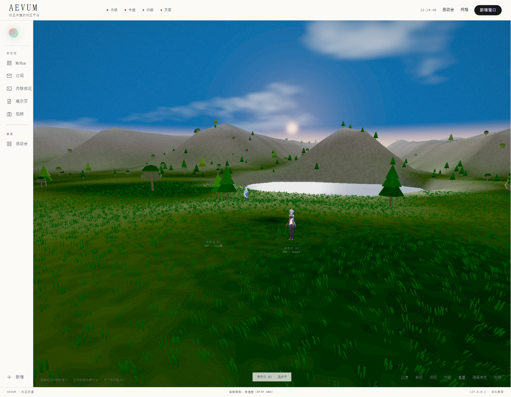
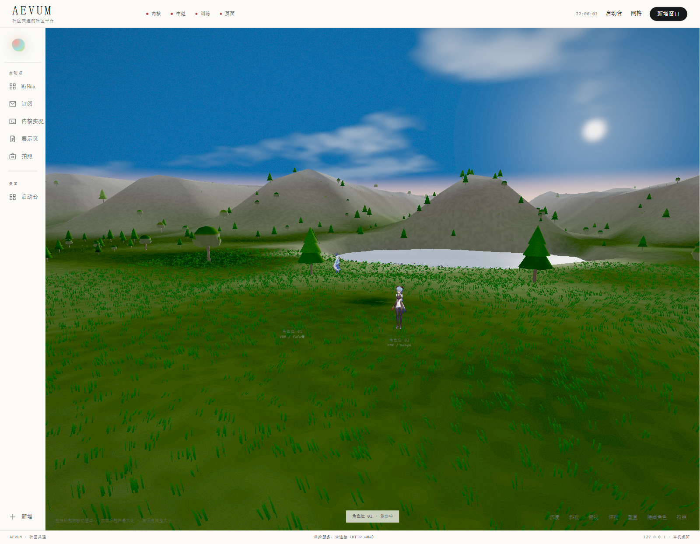
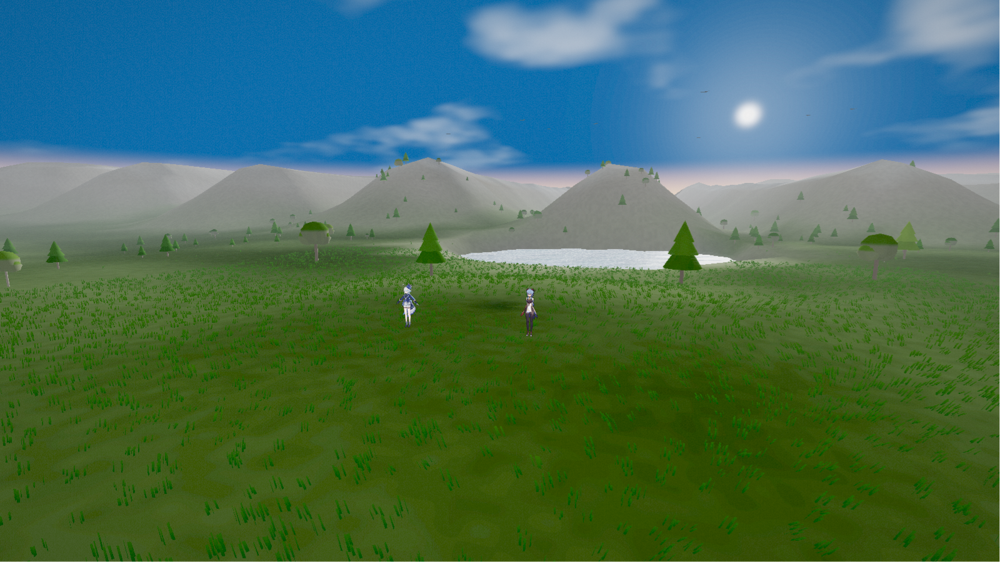
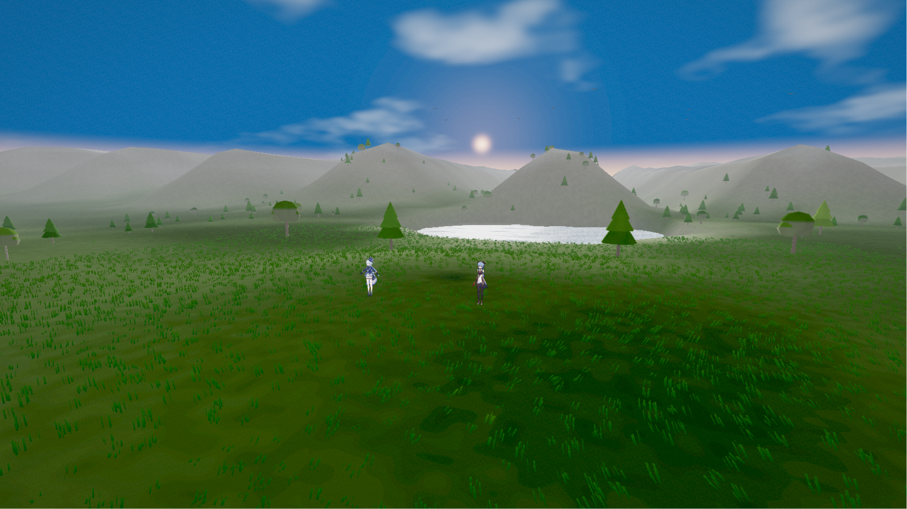
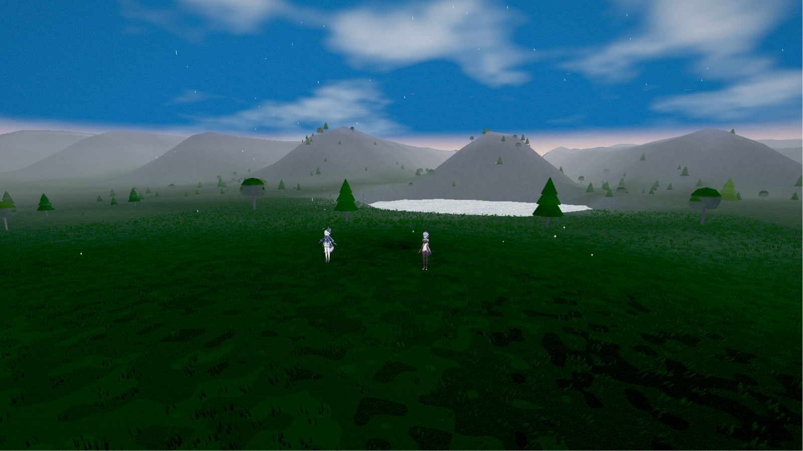

# Aevum

> 一个在浏览器里长草的开源项目。 / An open-source project that grows grass in a browser.  
> 目前的主要成就：一片草地、一个湖、两个小人，以及一个偶尔会 emo 下雨的天气系统。  
> Current achievements: one field, one lake, two small people, and a weather system that occasionally gets emo and rains.

<p align="center">
  
  <br>
  <sub>太阳下班前被山卡了一下。不是 bug，是晚高峰。</sub>
</p>

<p align="center">
  
  
  <br>
  <sub>左边：晴天。右边：它今天心情不太好。</sub>
</p>

这三张不是生成图，也不是宣传海报。是引擎在浏览器里真的跑出来的。  
所以画面里那些草、树、湖、雨、太阳和两个小人，都是活的——至少代码是这么认为的。

---

## 为什么你会点进来

大概率不是因为你现在需要一个社区平台。

你只是想知道：一个开源项目，为什么会在浏览器里长出一片草地，还养了两个小人。

这就够了。  
你不是来入职的，不用先读架构，不用背目录，也不用假装自己很关心“控制平面”。先看个乐子。

---

## 它到底是什么

Aevum 是一个社区共建的社区平台。说人话：它想做一个能跑内核、能训练、能渲染，还能把这三件事摆到同一张桌子上的开源底座。

目前桌子上的四个主要部件：

| 部件 | 人话 |
| --- | --- |
| **内核 / Kernel** | 让机器先站稳，别一开机就躺 |
| **AI 运行时 / AI Runtime** | 让机器有身份、有工具、有点记性 |
| **渲染引擎 / Render Engine** | 让机器有脸、有世界，别长得像 PPT |
| **控制平面 / Control** | 让上面三个别打架，顺便递个话 |

界面是独立的呈现层，`interface/web/` 是工作台和 3D 桌面，`interface/desktop/` 是 Electron 壳。Python 业务后端已经归档，不参与主线；它留下的位置，正好用来把三个核心做得更干净。

一句话：**这不是“又一个聊天框”，而是一个正在长身体的电子生物。**

---

## 现在能看到的怪东西

- **3D 桌面**：多窗口、角色槽位、相机、拍照模式；世界不是 iframe 贴图，是真长在 `scene-core` 的 3D 场景层里。拖一下会转，转多了会晕。
- **一片开放世界**：程序化地形、湖、树、草、云、太阳、昼夜、雨、雪、雾。晴天适合散步，雨天适合发呆，两个都适合截图。
- **世界现在有遥控器了**：右上角一个 `WORLD CONTROL`，时间滑杆、黎明 / 正午 / 黄昏 / 夜晚、晴 / 多云 / 雨 / 暴风雨 / 雪 / 雾都能直接按。拍照页是取景器风格；3D 桌面用同一套世界，但面板换成桌面原生的浅色样式，还能点「隐藏」收成一个小胶囊。
- **太阳会跟着时间走**：不用再改网址，拖动时间滑杆，太阳和月亮就会自己挪位置。想省事也可以继续用 `?time=0.72` 把它卡在山缝里。
- **天气会自己变，也可以手动管**：它仍然会偶尔自己换心情；但一旦你手动选了天气，它会先听你的，不会马上又自己切回去。
- **天空里的活物**：白天远处有一队 V 形鸟影，晚上换成萤火虫。它们不是贴图，也不是天气粒子；雪是雪，雨是雨，鸟是鸟，不要给它们改户口。
- **纯内存中继**：会话、上下文、分片传输、在线计数、交流房间。进程一停，数据就散；聊完就忘，比鱼还短记。
- **Libertas**：身份、工具、通知、治理、安全、隐私、沙箱。旧模块按职责拆开，不塞进一个叫 `core` 的黑洞。
- **Memoria**：C++ / LibTorch 的训练与生成内核。名字很严肃，产物是几个 `.exe`，跑起来像模像样。
- **Electron 桌面壳**：窗口、Windows 安装包、免安装目录都有；权重和语料默认不打包，毕竟仓库不是网盘。

---

## 世界现在有遥控器了

打开 `world.html`，右上角就是 `WORLD CONTROL`：

- **时间**：24 小时滑杆 + 黎明 `07:12` / 正午 `12:00` / 黄昏 `17:12` / 夜晚 `21:36`
- **天气**：晴 / 多云 / 雨 / 暴风雨 / 雪 / 雾

`desktop.html?world=1` 里的 3D 世界也有一份。桌面版不是再贴一块黑色调试窗，而是跟着桌面走的浅色面板；右上角点「隐藏」会收成一个 `世界环境` 小胶囊，点「显示」再展开。

这两个入口共用 `js/scene/world-controls.js` 和同一个 `window.AEVUM_WORLD_CONTROL`，所以不会出现“拍照页能切、桌面世界不会动”的分裂。

---

## 四个时刻 / Four moments

<p align="center">
  
  
  <br>
  
  
  <br>
  <sub>黎明 / 正午 / 黄昏 / 夜晚 · 桌面 3D 世界实时截图，已裁掉桌面外框<br>
  Dawn / Noon / Sunset / Night · live desktop 3D captures, outer desktop chrome cropped out</sub>
</p>

---

## 一封给路过的人的信 / A letter to whoever wandered in

**中文**

你大概不是来找一个“平台”的。你只是看见浏览器里有一片草地，草里站着两个小人，天上还有几只鸟，于是停下来两秒。够了。

Aevum 现在就像一个还没写完的世界：太阳会按时间上下班，天气有六种脾气，湖面会反光，鸟群会在远处拐弯。它不要求你留下，也不要求你懂“控制平面”。你可以只是拖一下视角，看草被风吹歪，然后关掉页面去吃饭。

如果它让你笑了半秒，这个项目今天就没有白活。想留下来，后门在 [CONTRIBUTING.md](CONTRIBUTING.md)；不想，前门就在右上角。

**English**

You probably didn't come here looking for “a platform”. You saw a field in a browser, two small characters standing in it, a few birds in the sky, and stopped for two seconds. That's enough.

Right now Aevum is an unfinished world: the sun clocks in and out, the weather has six moods, the lake catches the light, and the birds turn somewhere far away. It doesn't ask you to stay, or to understand a “control plane”. You can drag the view, watch the grass lean in the wind, and close the tab for dinner.

If it made you smile for half a second, the project did its job today. If you want to stay, the back door is [CONTRIBUTING.md](CONTRIBUTING.md); if not, the front door is the top-right corner.

---

## 诚实地说，它现在长到哪了

世界主链路已经接起来了，而且是真的在画面里跑：

- 程序化地形、16 个地形 chunk、LOD 选择、湖面和水波
- 天空、太阳 / 月亮、昼夜色温、雾、云量
- 树、草、花、雨、雪、暴风雨、萤火虫
- 相机环绕、视锥裁剪、方向光 / 环境光、阴影、调色和后处理链
- 对象系统：鸟群和萤火虫都通过 `addObject / getVisibleObjects` 真正进入了场景

仍然保守的地方也说清楚：

- **远景扩展植被层目前不绘制**：为了不再在山脊上出现浅色拖影，远景树走基础树组；`World3DExt.VegetationSystem` 的实例层先保持关闭。这不是能力缺失，是当前画质取舍。
- **树和草的影子仍然克制**：优先保证画面稳定，影子不是每个物体都全额发放。
- **不是每个扩展 API 都 100% 出镜**：主渲染链、六种天气、时间控制和桌面 3D 层已经可用；扩展模块还在按“先好看、再全量”的顺序上线。

所以现在的状态不是“宣传图很好看”，而是：**你打开页面，看到的就是这套引擎正在跑的样子。**

---

## 手痒，想自己跑一下

只起静态页面：

```powershell
cd D:\Aevum\interface\web
python -m http.server 8080
```

然后打开：

```text
http://127.0.0.1:8080/desktop.html?world=1
http://127.0.0.1:8080/world.html
http://127.0.0.1:8080/world.html?weather=rain
http://127.0.0.1:8080/world.html?time=0.72
```

起纯内存中继：

```powershell
cd D:\Aevum\control\relay
python -m relay --port 8790
```

跑不起来也别有压力。它不是你的作业，是它的作业。

---

## 只是路过

你不用参与，不用懂架构，甚至不用 star。

看到这里笑一下，这个项目的 KPI 就完成了。

如果你真的手痒，想提 issue、改代码、补文档，或者只是想把“树和草的影子”这个请假条批了，入口在这里：

- [CONTRIBUTING.md](CONTRIBUTING.md)
- [STRUCTURE.md](STRUCTURE.md)
- [ROADMAP.md](ROADMAP.md)

我们仍然欢迎 PR，只是不想把 README 写成入职培训。  
认真的人从后门进，路过的人从前门笑完就走，都行。

---

## 最后

代码以 **MPL-2.0** 授权，见 [LICENSE](LICENSE)。  
参与社区与仓库的行为受 [CODE_OF_CONDUCT.md](CODE_OF_CONDUCT.md) 约束，举报渠道 `open@mrhua.cn`。

仓库：`gitcode.com/AevumArk/Aevum`  
维护邮箱：`open@mrhua.cn`

> Aevum 现在还不是一个成熟项目。  
> 但它已经有一片草地、一个湖、两个小人，和一个会下雨的天气系统。  
> 这四样东西凑在一起，已经足够让人开心一下了。
