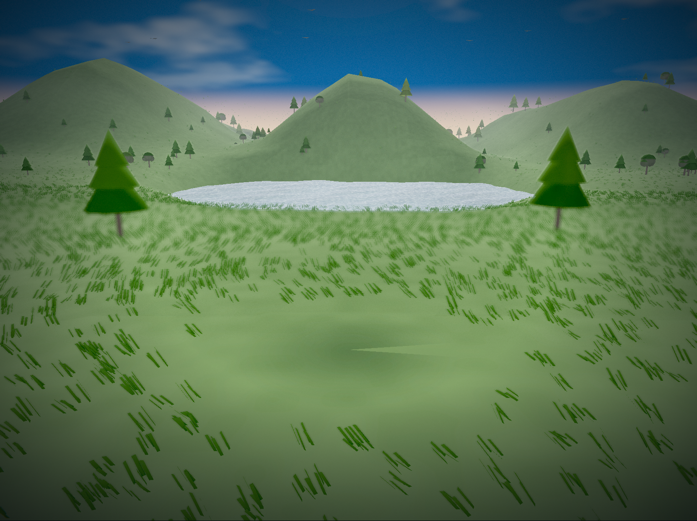
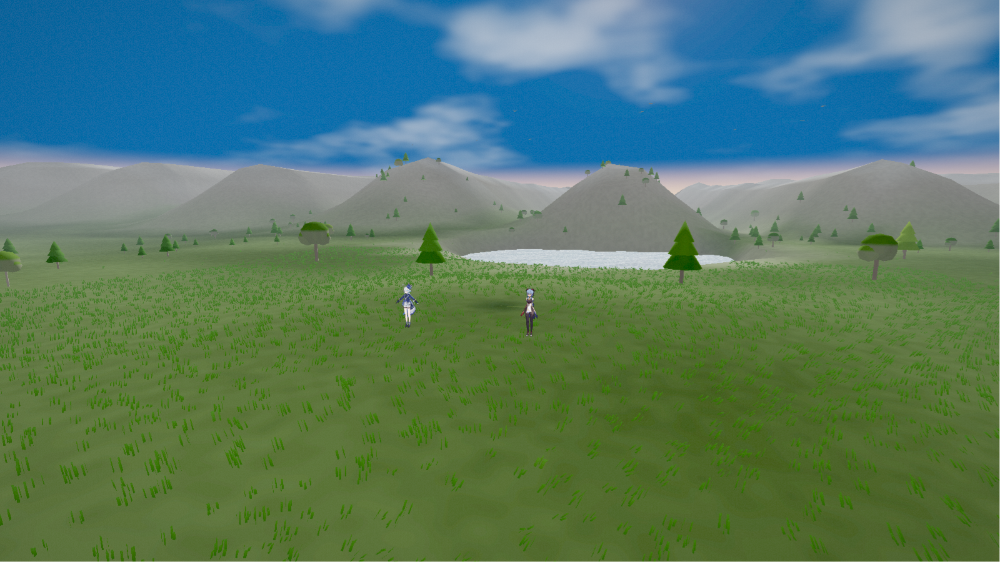
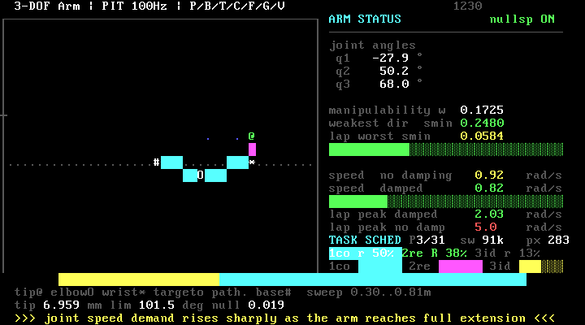
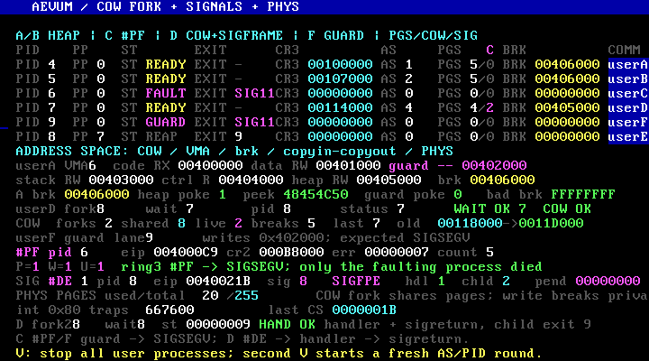
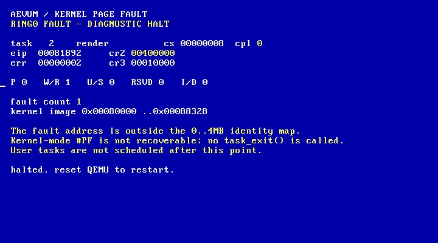
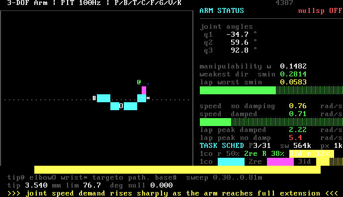

# Aevum

Aevum 是一个开源 3D 角色与世界运行时。当前仓库的重点是两条线：

- **渲染引擎**：WebGL2 角色渲染、PMX/MMD、VRM/glTF、Live2D，以及地形、天气、水体、植被和 LOD。
- **内核**：可运行的 32 位 x86 裸机内核，和一套用于设计验证的 Fortuna 内核骨架。

代码使用 MPL-2.0。模型、动作和贴图保留各自授权，不因为放进仓库就自动变成 MPL-2.0。

> Aevum is an open-source runtime for 3D characters and worlds. The current repository focuses on two tracks: a WebGL2 render engine, and a kernel effort that includes a runnable 32-bit x86 bare-metal kernel plus the Fortuna kernel skeleton. Code is MPL-2.0; models, motions and textures keep their own licenses.



当前构建的世界页面截图。地形、草地、树木、湖水和天空由引擎实时渲染。

> Screenshot from the current world build. Terrain, grass, trees, lake and sky are rendered by the engine at runtime.

## 项目结构 / Repository Layout

| 部分 | 路径 | 当前状态 |
| --- | --- | --- |
| 渲染引擎 | `engine/` | 可运行；`validate.html` 是主要验证入口 |
| 32 位裸机内核 | `src/kernel/host/console/robot/` | 可在 QEMU 运行；已完成 ring3、独立 CR3、`int 0x80`、VMA/brk/guard/copyin-copyout、COW fork、同步异常默认信号、用户 handler/signal frame/`sigreturn`、SIGCHLD/wait status、用户态与内核态 `#PF` 故障边界 |
| Fortuna 内核骨架 | `src/kernel/fortuna/` | 有 boot/mm/sched/fs/net/sandbox 等模块；设计验证阶段，没有稳定 CLI |
| 串口桥 | `src/kernel/host/bridge/` | 把内核 COM1 差量帧转为 WebSocket |
| Web / 桌面呈现层 | `interface/` | world、desktop、console；不属于引擎核心 |
| 控制平面 | `control/` | 运行时登记、进程启停、状态汇总、纯内存中继 |

> The repository separates the render engine, the runnable bare-metal kernel, the Fortuna kernel skeleton, the serial bridge and the presentation layer. The engine and the robot kernel are the two parts with runnable entry points today.

## 渲染引擎 / Render Engine

### 定位

`engine/` 是独立的 WebGL2 角色渲染引擎。它不依赖桌面壳，也不把 UI 业务混进引擎目录。模型格式各自保留解析器和 GPU 管线，不把 PMX、VRM、Live2D 强行转换成同一种内部格式。

> `engine/` is a standalone WebGL2 character renderer. It does not depend on the desktop shell, and format-specific parsers and GPU pipelines stay separate.

### 当前能力

| 能力 | 实现 |
| --- | --- |
| PMX / MMD | PMX 网格、材质、骨骼、Morph 解析；VMD 采样与播放；WebGL2 蒙皮、卡通着色、球面贴图、描边 |
| VRM / glTF | GLB/VRM 解析、Humanoid 骨骼、glTF accessor、蒙皮渲染 |
| Live2D | Cubism Core、moc3、纹理、参数、drawable、motion3、表情与动作 |
| 动作 | 动作状态机、动作捕捉、动作串联、动作匹配、关节 IK、程序化动作、Mixamo 到 VRM 重定向 |
| 世界 | 地形、天气、水体、植被、LOD、世界渲染管线 |
| 图形基础设施 | WebGL2 上下文、shader、buffer、FBO、后处理、transform feedback 风场 |

图形模块在 `engine/graphics/`，是 world 和 desktop 的唯一图形 owner。草摆动使用 `ComputeSimulator` 每帧生成风场，草顶点着色器读取 `GrassWind` UBO；world 源码不再保留等价的 inline 正弦摆动。

> PMX/MMD, VRM/glTF and Live2D each keep their own parser and renderer. Shared services cover math, resources, animation, skinning and world rendering. `engine/graphics/` is the single graphics owner; grass wind is driven by a transform-feedback compute pass and consumed by the grass vertex shader.

### 目录

```text
engine/
├─ validate.html              # 渲染验证入口
├─ models.yaml                # 对外演示清单
├─ math/                      # 向量、矩阵、四元数
├─ core/                      # ECS、渲染循环、资源管线、调度、性能统计
├─ graphics/                  # WebGL2、shader、buffer/FBO、后处理、compute
├─ formats/                   # glTF/GLB、VRM、PMX、VMD、TGA、motion3 解析
├─ loaders/                   # 格式适配、重定向缓存与 LOD
├─ animation/                 # 状态机、捕捉、串联、匹配、IK、程序化动作
├─ render/                    # VRM / PMX / Live2D / VMD / Morph / 视线 / 融合
├─ character/                 # Live2D 桥接、皮肤材质、延迟渲染扩展
├─ world/                     # 地形、天气、水体、植被、LOD、世界管线
├─ legacy/orb/                # 旧 Orb 实现，按需加载
└─ vendor/                    # Live2D Cubism Core 官方运行时
```

### 运行

在仓库根目录启动静态 HTTP 服务：

```powershell
python -m http.server 8766 --directory D:\Aevum
```

渲染验证页：

```text
http://127.0.0.1:8766/engine/validate.html
```

世界页：

```text
http://127.0.0.1:8766/interface/web/world.html
```

模型路径只写在 `engine/models.yaml` 或本地 `engine/assets/models.local.yaml` 中。模型、动作和贴图资产不进 Git；换成自己的模型时只改清单，不把路径写进 JS。

> Start a static HTTP server at the repository root, then open `engine/validate.html` or `interface/web/world.html`. Model paths live in `models.yaml` or the ignored local catalog; runtime code does not hard-code asset paths.

### 截图

| 世界天气 | 世界与角色 |
| --- | --- |
|  |  |

### 当前边界

- 未接 PBR / MToon。
- VRM 未接 SpringBone、表情 Morph。
- PMX 脚踝使用髋部补偿，不是逐骨骼足部 IK。
- 动作融合按骨骼分区，没有接触状态权重。
- Live2D 未接 physics3、PartOpacity 和完整 Cubism Framework 控制器。
- world 的近景草、树、水和角色仍是测试级资产与材质。

> Current limits: no PBR/MToon; no SpringBone or VRM expression morphs; PMX ankle handling is a hip compensation, not per-bone foot IK; animation blending is bone-partitioned; Live2D physics3 and full Cubism Framework control are not connected; close-up world assets remain test-grade.

## 内核 / Kernel

仓库里的“内核”分两条线，不能混为一谈：

1. **可运行的裸机内核**：`src/kernel/host/console/robot/`，NASM + C，32 位 x86，当前在 QEMU 中启动。
2. **Fortuna 内核骨架**：`src/kernel/fortuna/`，按 boot、内存、调度、文件系统、网络、沙箱拆模块，用于设计验证，不是当前 Web 主链路的运行依赖。

> The repository contains two kernel tracks: a runnable 32-bit x86 bare-metal kernel under `host/console/robot`, and the Fortuna kernel skeleton under `fortuna`. Fortuna is a design-validation track, not a runtime dependency of the Web application.

### 1. 32 位裸机内核 / Bare-metal kernel

这个内核不依赖 libc，也不跑在桌面操作系统里。BIOS 引导扇区把 96 个扇区读到 `0x80000`，进入保护模式、建立 GDT、IDT、TSS 和 0–4 MB 恒等分页，然后运行内核任务。

> This kernel does not use libc and does not run on top of a desktop OS. The BIOS boot sector loads 96 sectors to `0x80000`, enters protected mode, builds GDT/IDT/TSS and identity-maps 0–4 MB, then starts kernel tasks.

#### 已实现

| 模块 | 实现 |
| --- | --- |
| 启动 | `robot/boot.asm` 一次 LBA 读 96 个扇区到 `0x80000`；`loader.asm` 清 BSS、加载 6 项 GDT、启用 FPU/SSE |
| 中断 | 256 项 IDT；PIT 100Hz IRQ0；8259A PIC 重映射；`int 0x40` 软件调度门；`int 0x80` DPL3 系统调用门；`#DE/#BP/#UD/#GP` 同步异常门 |
| 任务 | 10 个固定任务槽（3 内核 + 6 用户 + 1 余量）；独立内核栈；统一中断帧；`task_yield/block/wake/exit`；优先级加权 `vruntime` 调度 |
| 上下文 | `fxsave/fxrstor` 保存 FPU/SSE；每个任务栈底预留 512 字节 FXSAVE 区 |
| 内存 | 内核页目录/页表固定在 `0x10000/0x11000`；用户 PD/PT 与用户页从 `0x100000..0x1FEFFF` 的 255 页位图池分配；每页有引用计数 |
| 进程模型 | `kernel/proc/process.c` 唯一维护 PCB、PID、父子关系、退出码、信号 pending/SIGCHLD、每进程 handler 表、`wait/reap`；`task.c` 只管调度/内核栈/FPU，`address_space.c` 只管 PD/PT/VMA/物理池/brk/COW |
| ring3 | 6 个用户地址空间槽；同一段用户代码映射到相同 VA `0x400000`；V 页跑 A/B/C/D/F，D 做两轮 fork/wait，第二轮用 `SIGFPE` handler 捕获 `#DE` |
| COW fork | 新 PD/PT，所有可写用户页（data/stack/heap，以及内核可写的 control 页）清 RW、置 PTE bit 9 共享；已是 COW 的页第二次 fork 时保留 COW 位；写 #PF 或 copyout 写时复制，引用计数归零才归还物理页 |
| 系统调用 | `eax=2` yield、`3` exit(code)、`4` wait(pid,status)、`5` getpid、`6` fork、`7` getppid、`8` brk、`9` peek、`10` poke、`11` sigaction(sig,handler,mask)、`12` sigreturn；内核记录调用次数和真实 `CS=0x1B` |
| 地址空间 | 6 个 VMA：code RX `0x400000`、data RW `0x401000`、guard 无权限 `0x402000`、stack RW `0x403000`、control R `0x404000`、heap RW `0x405000..0x410000`；guard 有 VMA 无 PTE |
| 同步异常 | `exception.c` 独占 IDT 0/3/6/13；CPL3 时 `#DE -> SIGFPE(8)`、`#BP -> SIGTRAP(5)`、`#UD -> SIGILL(4)`、`#GP -> SIGSEGV(11)`；有 handler 时在用户栈构造 signal frame，无 handler 才默认终止当前进程；CPL0 非 #PF 异常停机 |
| 信号与 wait | `pending` 位图；`sigactions[32]` 存 handler/mask/flags；`fork` 继承 handler 表与 mask；子进程退出给父进程置 `SIGCHLD(17)`；正常 `exit(7)` status 为 `7`，默认信号终止为 `0x80000000` 按位或 `sig`，`#DE` 为 `0x80000008` |
| signal frame | 用户栈 64 字节：trampoline VA + 原 GPR + `eip/cs/eflags/esp/ss` + `sig/old_mask/magic`；`#DE` 保存 EIP 按 `F6/F7` 指令长度前移；`sigreturn` 读回并恢复原 iret 帧 |
| 故障隔离 | IDT 第 14 项 `#PF`；记录 `CR2/ERR/EIP/CS/PID`；heap 缺页零填重试、COW 写页复制重试，guard/RO/非法地址以 `SIGSEGV` 终止当前进程 |
| 内核态故障页 | `K` 键从 kernel task 写 `0x00400000`（PDE 1 未映射）触发 CPL0 `#PF`；页面显示 PID/任务名、CS/CPL、EIP、CR2、ERR、CR3、P/W/U/RSVD/I-D、fault count、recoveries 与 kernel image 范围；`R` 临时建立 PDE 1、执行完出错写并 `iret` 返回，`H` 停机 |

#### 当前验收数据

| 项 | 当前值 |
| --- | --- |
| `kernel.bin` | 44,392 字节，小于 96 扇区上限 49,152 字节 |
| 加载基址 | `0x80000`；boot 读取窗口 `0x80000..0x8C000` |
| BSS | `0x8AD60..0x8D3C0`，由 loader 清零 |
| 常驻任务 | `control` / `render` / `idle` |
| 用户任务 | `userA` / `userB` / `userC` / `userD` / `userF`，D 第二轮 fork 的子进程复用 PID 8；PD/PT 从 `0x100000` 起按池分配 |
| 用户虚拟地址 | code `0x400000`、data `0x401000`、guard `0x402000`、stack `0x403000`（栈顶 `0x404000`）、control `0x404000`、heap `0x405000..0x410000` |
| 地址空间证据 | A/B `brk 0x406000`；heap `0x405800` poke/peek `0x48454C50`；越界 `brk(0x500000)` 返回 `0xFFFFFFFF`；guard poke 返回 0 |
| COW 证据 | D `forks 2 shared 8 live 2 breaks 5`，`last AS4 old 00118000 -> 0011B000`；子写 `CHLD`、父读回 `PAPA`，V 页显示 `COW OK`；第二次 fork 保留已有 COW 位，signal frame 写栈也触发一次拆分 |
| 故障样例 | `#PF count 3`：C 写 `0xB8000`（`cr2 000B8000 err 00000007`）、F 写 guard `0x402000`，以及 COW 子页写路径；C `FAULT/SIG11`、F `GUARD/SIG11` |
| 同步异常样例 | D 第二轮子进程 `1/0` 触发 `#DE`：`pid 8 eip 0040021B sig 8 SIGFPE hdl 1`；signal frame 进入 handler，`sigreturn` 返回 `0x40021D`，父 `wait 8` 得到 `00000009`，V 页显示 `HAND OK` |
| 进程闭环 | 第一轮 D `fork 8`，子 `exit(7)`，父 `wait 8` 得到 status 7；第二轮 `fork2 8`，子 handler 捕获 `#DE` 后 `exit(9)`，父 `wait 8` 得到 `9`；两次 SIGCHLD 都被 wait 消费，`pend 00000000` |
| 物理池 | `PHYS PAGES 26/255`；停止后无 ZOMBIE/PID/页泄漏；signal frame 与 handler 没有额外泄漏 |
| 内核态故障样例 | `#PF task 2 render cs 00000008 cpl 0 eip 000837C1 cr2 00400000 err 00000002 cr3 00010000` |
| 内核态故障结果 | `P=0 W/R=1 U/S=0 RSVD=0 I/D=0`；页面进入 `RING0 FAULT - CONTROLLED PROBE`，按 `R` 后 fault 执行成功并返回主画面；kernel image 范围 `0x80000..0x8D400`；独立 K 探针 `fault count 1` |

`userC` 在数据页写入 `mode=1`，数到 5000 后故意写内核显存 `0xB8000`；`userF` 在 `mode=3` 直接写 guard `0x402000`。CPU 触发 `#PF`，内核读取 `CR2/ERR/EIP`，以 `process_terminate_current(SIGSEGV)` 终止并回收当前用户任务，A/B 继续运行。D 第一轮 fork 的子页首次写入走 COW `#PF` 路径，`address_space` 识别 PTE 的 COW 位后复制私有页并返回原帧重试；第二轮子进程先 `sigaction(SIGFPE, handler, 0)`，再执行 `1/0` 触发 `#DE`，`exception.c` 查 handler 后在用户栈构造 signal frame，handler 计数后 `sigreturn` 回到 `0x40021D`，子进程写 `HAND` 并 `exit(9)`，父进程 `wait` 得到 `9`。机械臂主画面和 V 页的 q 值保持正常，说明 COW、#PF、signal frame 和 `sigreturn` 路径都没有破坏调度器与 FPU 状态。

> `userC` writes the kernel VGA buffer at `0xB8000` after 5,000 iterations; `userF` writes the unmapped guard page. The kernel records `CR2/ERR/EIP`, terminates only that process with `SIGSEGV`, and leaves `userA/userB` running. D's first COW child write takes the COW `#PF` path and gets a private page. Its second child installs a `SIGFPE` handler and then divides by zero; `exception.c` builds a user-stack signal frame, the handler runs, `sigreturn` resumes at `0x40021D`, and the child writes `HAND` and exits 9. The parent's `wait` receives 9. The arm page and joint values remain valid after both paths.

内核态边界单独验证：在机械臂主画面按 `K`，kernel task 主动写 `0x00400000`。该地址正好越过 0–4 MB 恒等映射，PDE 1 不存在，CPL0 触发 `#PF`（`ERR=0x2`，P=0、W=1、U=0）。panic 页先 `cli` 阻止递归 fault，再打印现场；此时按 `R`，内核临时把 PDE 1 指向 `0x13000` 页表、PTE 0 指向 `0x14000` 诊断页，执行完出错写指令后通过原异常帧 `iret` 返回，再撤销映射并重新武装 `K`。按 `H` 或遇到非探针内核 fault 仍走停机路径。

> Kernel-mode boundary: pressing `K` makes the kernel task write `0x00400000`, just past the 0–4 MB identity map. With PDE 1 absent, CPL0 raises `#PF` (`ERR=0x2`, P=0, W=1, U=0). The panic page runs `cli` first and renders the saved frame. Pressing `R` installs a temporary PDE 1/PTE 0 mapping (`0x13000` page table, `0x14000` diagnostic page), lets the faulting store execute, returns through the original exception frame with `iret`, then unmaps the page and re-arms `K`. `H`, or any non-probe kernel fault, still halts.

#### 截图

| 机械臂主画面 | COW + signal frame + handler + 物理池 |
| --- | --- |
|  |  |
| 内核态 `#PF` 受控探针 | 按 `R` 恢复后的主画面 |
|  |  |

#### 构建与运行

需要 Linux 或 WSL2，以及 `nasm`、支持 `-m32` 的 `gcc`、`binutils`、`make`、`qemu-system-i386`：

```bash
cd src/kernel/host/console/robot
make clean && make all
make run
```

只构建镜像：

```bash
make all
# 产物：kernel.bin、disk.img、os.img
```

无界面启动：

```bash
qemu-system-i386 -drive format=raw,file=disk.img -display none
```

调试：

```bash
make debug
# 另一个终端：gdb，target remote :1234
```

> Build with NASM, 32-bit GCC, binutils and QEMU on Linux/WSL2. `make all` produces `kernel.bin`, `disk.img` and `os.img`; `make run` starts QEMU; `make debug` waits for GDB on port 1234.

#### 当前边界

- 单核、平坦段、固定 255 页物理池。
- 没有 ELF 加载、`exec`、fd/pipe；已有用户态 handler/signal frame/`sigreturn`，但没有 `kill()`、信号排队或真正阻塞的 mask。`wait` 仍是 `task_yield()` 轮询，不是阻塞睡眠。
- `TASK_MAX=10`、`PROC_MAX=8`、`AEVUM_AS_MAX=6`；`V` 跑 A/B/C/D/F 五个用户任务，D 做两轮 fork/wait。
- `fork` 已改为 COW：可写用户页共享、写时复制；control 页对用户只读，但内核写停止字前也会先拆分。
- `family.c` 只维护内核任务树；用户进程父子关系由 `process.c` 维护，G 页与 V 页是两套树。
- 内核态 `#PF` 已能捕获并显示现场；只有 `K` 的受控探针可按 `R` 临时修复 PDE 1、执行完出错指令并 `iret` 返回，然后撤销映射重新武装。非探针内核 fault 仍是终止性诊断；双重 fault、栈溢出仍未处理。
- 这是教学与验证内核，不是生产内核。

> Single-core, flat segments and a fixed 255-page physical pool. No ELF loading, `exec`, fd/pipe or `kill()`; user handlers, signal frames and `sigreturn` exist, but signal queues and blocking masks do not. `wait` polls with `task_yield()` instead of sleeping. `TASK_MAX=10`, `PROC_MAX=8` and six address-space slots are the hard limits. `fork` is copy-on-write: writable user pages are shared, an already-COW page keeps its COW bit across a second fork, and the faulting writer gets a private copy; the user-read-only control page is split before the kernel writes its stop word. `family.c` still owns only the kernel-task tree; the user-process tree lives in `process.c`. Kernel-mode page faults are captured and rendered with a full register dump. Only the controlled `K` probe can recover: `R` installs a temporary PDE 1, lets the faulting store complete, returns through `iret`, then unmaps. Unexpected kernel faults remain terminal; double faults and stack overflow still halt. This is a teaching and validation kernel, not a production kernel.

### 2. Fortuna 内核骨架 / Fortuna kernel skeleton

`src/kernel/fortuna/` 按职责拆成 `arch/`、`boot/`、`core/`、`mm/`、`sched/`、`fs/`、`net/`、`sandbox/`、`security/`、`drivers/`、`irq/`、`ipc/` 等目录。目标是先把启动、内存、调度、文件系统、网络和沙箱的边界拆清楚，再逐块补实现和测试。

现状：

- 有模块和目录，不是完整可用的操作系统。
- 没有稳定的命令行入口；开发时通过 Python 导入模块并跑局部测试。
- 不是 Web 主链路的运行依赖。
- 设计说明见 `docs/fortuna/design.md`，使用说明见 `docs/fortuna/usage.md`。

> Fortuna is split by kernel responsibility into architecture, boot, core, memory, scheduler, filesystem, network, sandbox, security, drivers, IRQ and IPC modules. It is a design and validation skeleton, not a complete OS; there is no stable CLI yet and it is not a runtime dependency of the Web application.

### 3. 串口桥 / Serial bridge

`src/kernel/host/bridge/serial_bridge.py` 读取内核 COM1 输出的差量帧：

```text
A5 5A 01 COUNT [row col ch attr] CRC
```

然后把变化单元格转成 WebSocket 消息，供桌面「内核实况」窗口显示。没有这段桥，内核仍然会写 `0xB8000`，但桌面收不到画面。

> The bridge reads the kernel's COM1 delta frames and forwards changed text cells over WebSocket to the desktop kernel view. Without it the kernel still writes VGA memory, but the desktop cannot display the frames.

## 快速验证 / Quick Checks

渲染引擎：

```powershell
cd D:\Aevum
python -m http.server 8766 --directory D:\Aevum
```

打开：

```text
http://127.0.0.1:8766/engine/validate.html
http://127.0.0.1:8766/interface/web/world.html
```

内核：

```bash
cd src/kernel/host/console/robot
make clean && make all
make run
```

模型、动作、贴图和内核构建产物按各自目录规则管理；不要把本地资产或生成物直接提交到 Git。

> Use the engine validation page and world page for render checks. Build and run the robot kernel from its own directory. Keep local assets and generated files out of Git.

## 许可 / License

代码是 **MPL-2.0**，见 [LICENSE](LICENSE)。行为准则见 [CODE_OF_CONDUCT.md](CODE_OF_CONDUCT.md)，参与开发见 [CONTRIBUTING.md](CONTRIBUTING.md)。仓库地址：`https://gitcode.com/AevumArk/Aevum`，维护邮箱：`open@mrhua.cn`。

角色模型、贴图和动作素材各自遵循原授权。代码许可证不覆盖这些资产。

> Code is MPL-2.0. Models, textures and motion data keep their original licenses; the code license does not relicense them.

## 相关文档 / Related Docs

- 引擎架构：`engine/ARCHITECTURE.md`
- 引擎逐文件清单：`engine/JS-MODULES.md`
- 裸机内核说明：`src/kernel/host/console/robot/README.md`
- 裸机内核施工说明：`src/kernel/host/console/robot/CONSTRUCTION.md`
- 内核构建说明：`src/kernel/host/console/robot/INTRO.md`
- Fortuna 设计：`docs/fortuna/design.md`
- 目录边界：`STRUCTURE.md`
